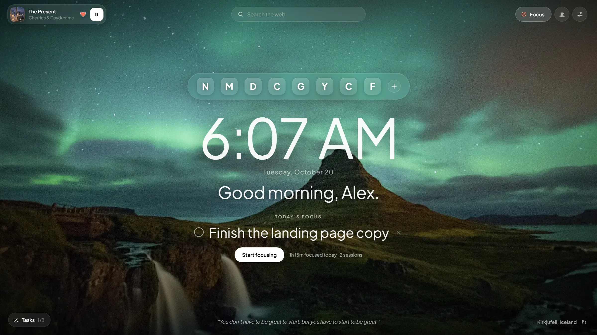
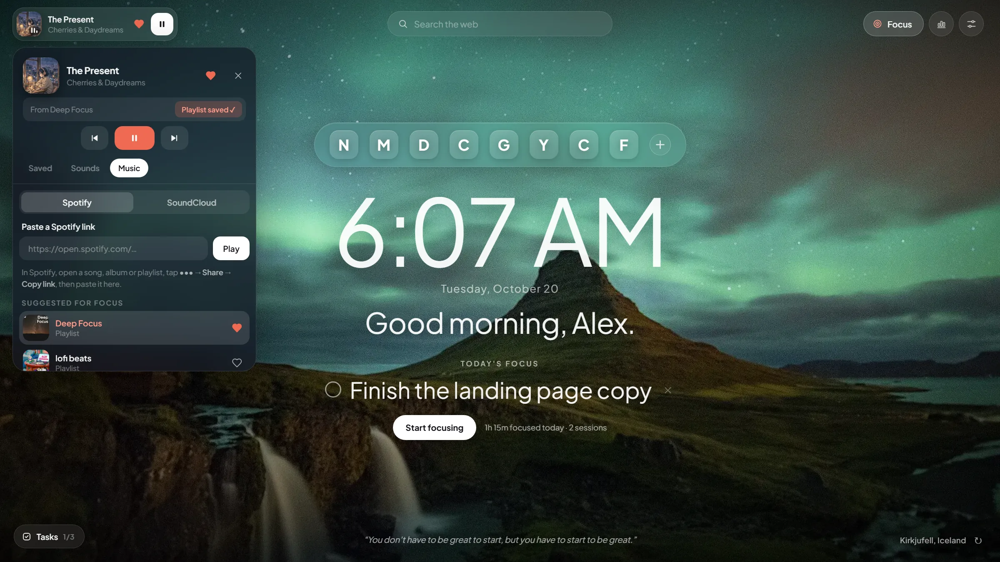
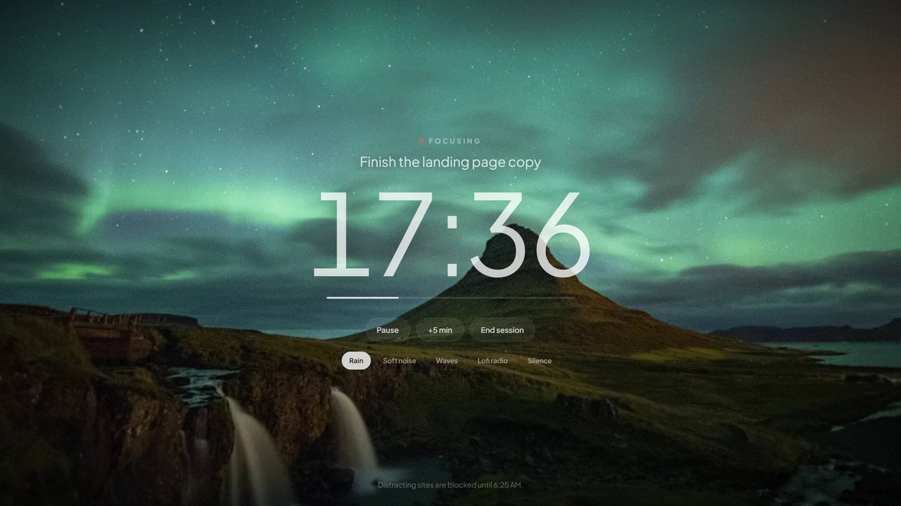
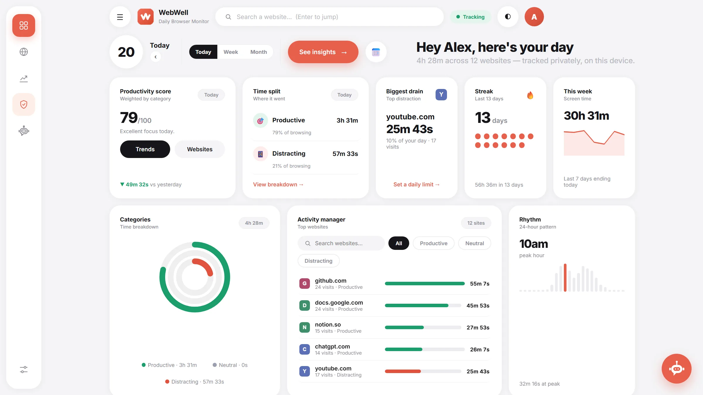
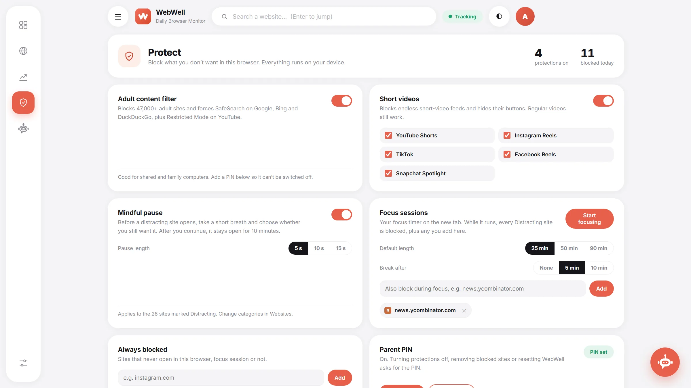

  

<h1 align="center">WebWell</h1>

  A calmer new tab for Brave and Chrome. Focus sessions with music, site blocking when you want it, 
  and honest numbers about where your time goes. Free, and private on your device.

  <a href="https://chromewebstore.google.com/detail/webwell/mnjakeggjhfdookcdgjdgmamhcobnofi"><b>Add to Chrome, it's free</b></a>
  &nbsp;·&nbsp;
  <a href="https://webwell.app"><b>webwell.app</b></a>
  &nbsp;·&nbsp;
  <a href="https://webwell.app/blog">Blog</a>

  
  
  
  

<i>Written & Developed by <b><a href="https://adnankhan.cc">Adnan</a></b></i>

---

  

<table>
  <tr>
    <td width="50%"> <b>Music</b> · Spotify, SoundCloud and offline sounds, one click away</td>
    <td width="50%"> <b>Focus</b> · a full-screen timer with calming sound</td>
  </tr>
  <tr>
    <td width="50%"> <b>Dashboard</b> · your score, time split and week at a glance</td>
    <td width="50%"> <b>Protect</b> · adult-content and short-video blockers, mindful pause</td>
  </tr>
</table>

*Everything is tracked **privately, on your device**. Nothing ever leaves your browser.*

## ✨ Features

- ⏱️ **Automatic time tracking** — active-tab time per website (pauses when you're idle or the window loses focus)
- 📊 **Command dashboard** — productivity score, time split, streaks, trends, 24-hour rhythm, category breakdowns
- 💬 **Ask WebWell (AI)** — chat with your stats: *"when am I most distracted?"* (needs a free Gemini key — 2-minute setup in Settings)
- 🔮 **Distraction forecast** — learns your slump hours and warns you 15 minutes before
- 🖼️ **Momentum-style new tab** — landmark photos with facts, a daily focus you can start a session from, tasks, greeting, web search
- 🎧 **Music on your new tab** — a compact player with lofi radio, offline rain/noise/wave sounds, Spotify and SoundCloud; tap the ♥ to save a song and it's one click away on every new tab
- ⏳ **Focus sessions** — a full-screen focus timer with offline rain/noise/wave sounds or lofi radio; distracting sites are blocked until you're done
- 🛡️ **Protect** — adult-content filter (95,000+ domains, SafeSearch, YouTube Restricted Mode), short-video blocker (Shorts, Reels, TikTok), always-blocked sites, mindful pause, parent PIN
- 🎯 **Site limits & nudges** — daily limits per site, gentle check-ins
- 🧾 **Shareable week cards** — download a beautiful image of your week for social media
- 👤 **Local profile** — your name, picture, and themes; your data stays yours
- 🐞 **In-app bug reporting**

## 🚀 Install

**Easiest: [Add WebWell from the Chrome Web Store](https://chromewebstore.google.com/detail/webwell/mnjakeggjhfdookcdgjdgmamhcobnofi)** (works in Chrome and Brave, one click).

### Or install from source (about 2 minutes)

1. Click the green **Code** button above → **Download ZIP**
2. **Extract** the downloaded ZIP file (right-click → Extract all)
3. Open Brave and go to `brave://extensions` (Chrome users: `chrome://extensions`)
4. Turn on **Developer mode** — the toggle in the top-right corner
5. Click **Load unpacked** → select the extracted folder (the one containing `manifest.json`)
6. Done! Click the puzzle piece 🧩 in your toolbar → pin **WebWell** so it's always one click away

> **New tabs:** open a new tab to meet your focus page — set your name, your focus for the day, and your tasks.
>
> **AI chat:** Settings → AI features → follow the 3-step guide to add a free Gemini key (takes 2 minutes, key never leaves your browser).

## 🔒 Privacy

- All tracking data is stored **only in your browser's local storage**. No servers, no accounts, no analytics.
- Optional AI features send *only* your question plus a short stats summary to Google's Gemini API, and only when you ask — using **your own** API key.
- Blocking runs on Chrome's built-in rules, with the block list shipped inside the extension. Site access is only requested when you turn a blocking feature on.
- Uninstalling the extension deletes everything.

Read the full policy at [webwell.app/privacy](https://webwell.app/privacy).

## 🐞 Bug reports & feedback

Found something broken? [Report it here](https://docs.google.com/forms/d/e/1FAIpQLSc3o1kfbSudJYkBzvkUIA0NCeifbXgTccBnzUps0IlZq1Exdg/viewform) — it takes 30 seconds.

## 📄 License

MIT — see [LICENSE](LICENSE). © 2026 Adnan. Third-party data and media: [THIRD-PARTY-NOTICES.md](THIRD-PARTY-NOTICES.md).
