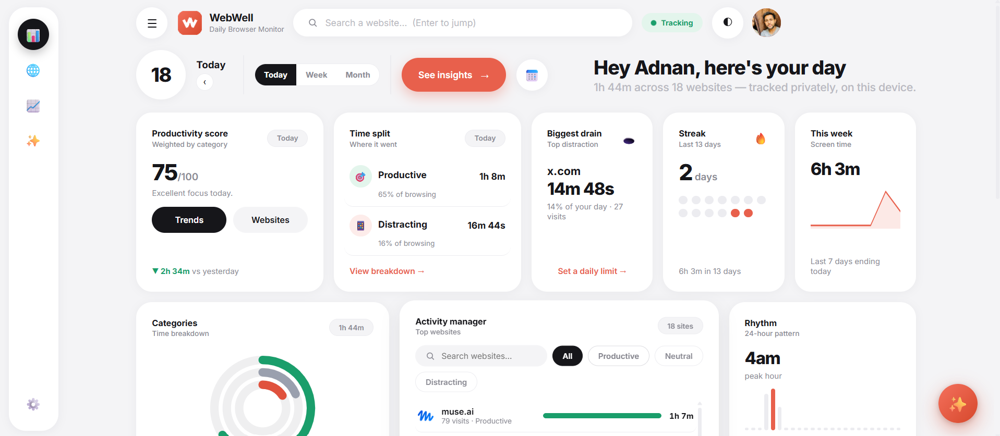

  

<h1 align="center">WebWell — Daily Browser Monitor</h1>

  Your Digital Wellbeing for the desktop. See which websites take your time, 
  score your productivity, and get warned about your biggest time sinks.

  
  
  
  

<i>Written & Developed by <b>Adnan</b></i>

---

*Everything is tracked **privately, on your device**. Nothing ever leaves your browser.*

## ✨ Features

- ⏱️ **Automatic time tracking** — active-tab time per website (pauses when you're idle or the window loses focus)
- 📊 **Command dashboard** — productivity score, time split, streaks, trends, 24-hour rhythm, category breakdowns
- ✨ **Ask WebWell (AI)** — chat with your stats: *"when am I most distracted?"* (needs a free Gemini key — 2-minute setup in Settings)
- 🔮 **Distraction forecast** — learns your slump hours and warns you 15 minutes before
- 🖼️ **Momentum-style new tab** — landmark photos with facts, daily focus, tasks, greeting, live stats
- 🎯 **Site limits & nudges** — daily limits per site, gentle check-ins
- 🧾 **Shareable week cards** — download a beautiful image of your week for social media
- 👤 **Local profile** — your name, picture, and themes; your data stays yours
- 🐞 **In-app bug reporting**

## 🚀 Install (2 minutes)

1. Click the green **Code** button above → **Download ZIP**
2. **Extract** the downloaded ZIP file (right-click → Extract all)
3. Open Brave and go to `brave://extensions` (Chrome users: `chrome://extensions`)
4. Turn on **Developer mode** — the toggle in the top-right corner
5. Click **Load unpacked** → select the extracted folder (the one containing `manifest.json`)
6. Done! Click the puzzle piece 🧩 in your toolbar → pin **WebWell** so it's always one click away

> **New tabs:** open a new tab to meet your focus page — set your name, your focus for the day, and your tasks.
>
> **AI chat:** Settings → AI features → follow the 3-step guide to add a free Gemini key (takes 2 minutes, key never leaves your browser).

## 🔒 Privacy

- All tracking data is stored **only in your browser's local storage**. No servers, no accounts, no analytics.
- Optional AI features send *only* your question plus a short stats summary to Google's Gemini API, and only when you ask — using **your own** API key.
- Uninstalling the extension deletes everything.

See [PRIVACY-POLICY-draft.md](PRIVACY-POLICY-draft.md) for the full draft.

## 🐞 Bug reports & feedback

Found something broken? [Report it here](https://docs.google.com/forms/d/e/1FAIpQLSc3o1kfbSudJYkBzvkUIA0NCeifbXgTccBnzUps0IlZq1Exdg/viewform) — it takes 30 seconds.

## 📄 License

MIT — see [LICENSE](LICENSE). © 2026 Adnan.
